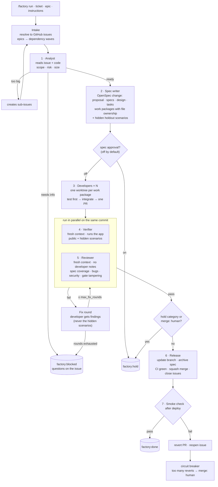

# open-factory

**A software factory for Claude Code.** Give it a ticket, an epic, a sentence of instructions, or a queue of ready
issues. A team of agents analyses the work, writes an [OpenSpec](https://openspec.dev) spec, builds it with parallel
developers, verifies it against hidden scenarios, reviews it independently, merges it and smoke-checks production.

> Status: proof of concept. By default it runs as a *dark factory*: no human reads the spec or the code before it
> merges. Read [Safety](#safety) before pointing it at a production repo.

```
/factory "Add CSV export to the invoices page"
/factory ticket #142
/factory epic "Billing v2"
/factory run
```

## How it works



The main Claude Code session is the **orchestrator**. Subagents can't spawn subagents, so it spawns every agent
itself, each with a fresh context. All state lives in GitHub: one `factory:<stage>` label per issue, one marker
comment per stage, and the spec on the change branch. A crashed or interrupted run picks up where it left off on
the next `/factory run`.

## The steps

| # | Step | Agent (default model) | What it does | Leaves behind | Exits early when |
| --- | --- | --- | --- | --- | --- |
| 0 | **Intake** | orchestrator | Turns the arguments into issues. Instructions become a new issue; an epic becomes its sub-issues, ordered in dependency waves; `run` takes every `factory:ready` issue plus anything in flight. | issues with labels | an issue is blocked, held or stopped |
| 1 | **Analyse** | analyst (Opus) | Reads the issue and the code, checks for duplicates, and decides ready, needs-info, split or reject. Classifies risk, size and sensitive categories (auth, payments, migrations…). Read-only. | analysis comment | needs-info → questions posted; too big → sub-issues created |
| 2 | **Spec** | spec-writer (Opus) | Writes an OpenSpec change on `factory/<id>`: proposal, delta specs (requirements, each with WHEN/THEN scenarios), design, and tasks grouped into **work packages** with file ownership and dependencies. Validates with `openspec validate --strict`. Also writes 3–8 **holdout scenarios** outside the repo that the developers never see. | `openspec/changes/<id>/`, `.factory/holdout/<id>.md` | the spec can't be made valid |
| 3 | **Build** | developer × N (Opus) | One developer per work package, each in its own git worktree, in dependency waves: tests first, then code, then lint, types, tests and build. With more than one package, an integrator merges the package branches and opens **one PR per issue**. The orchestrator picks N from the packages, capped by `max_parallel_developers`. | PR with `Closes #n` | a developer is blocked |
| 4 | **Verify** | verifier (Sonnet) | Fresh context; its job is to prove the change doesn't work. Runs every check, starts the app and exercises every public and hidden scenario for real (HTTP, CLI, browser), not by reading the code. Scores hidden scenarios as *satisfaction*. | verification comment | — (failures go to a fix round) |
| 5 | **Review** | reviewer (Opus) | Fresh context and deliberately no developer notes. Checks spec coverage (requirement → code → test), correctness, security, data safety, and **gate tampering** (skipped tests, loosened lint, edited CI). | review comment | — (blocking findings go to a fix round) |
| ↺ | **Fix round** | developer (Opus) | Gets the reviewer's findings word for word, and the verifier's failures as *violated requirement + observed behaviour*, never the hidden scenario. Then verify and review run again. | fix-round comment | `max_fix_rounds` used up → `factory:blocked` |
| 6 | **Release** | release (Sonnet) | One at a time (a merge queue): updates the branch, archives the OpenSpec change into the living specs, waits for CI, squash-merges and checks the issues closed. | merged commit, updated `openspec/specs/` | merge refused, or a hold applies |
| 7 | **Smoke** | release (Sonnet) | Waits for the deployment and runs your smoke command. On failure it reverts at once, reopens the issue, and counts the revert toward the circuit breaker. | release comment | smoke fails → revert |

## Install

Requirements: [Claude Code](https://claude.com/claude-code), `git`, the [GitHub CLI](https://cli.github.com)
(signed in, with write access to the repo), and the OpenSpec CLI (`npm i -g @fission-ai/openspec`).

**As a plugin** (every repo on your machine):

```
/plugin marketplace add ludmal/open-factory
/plugin install open-factory@open-factory
```

**Or copy it into one repo:** copy `skills/factory/` to `<your repo>/.claude/skills/factory/`.

Then, in the repo:

```
/factory init
```

`init` writes `factory.yaml` (detecting your lint, test and build commands), runs `openspec init`, creates the
labels, git-ignores `.factory/`, checks your CI and branch protection, and opens a setup PR. **You merge that one
yourself.** The skill is `/factory`, or `/open-factory:factory` if another skill is already called `factory`.

## Commands

| Command | Does |
| --- | --- |
| `/factory init` | One-time setup PR |
| `/factory run` | Works through every `factory:ready` issue and resumes in-flight ones |
| `/factory ticket <#, URL or title words>` | One issue |
| `/factory epic <#, milestone or title>` | A parent issue's sub-issues, a milestone, or an `epic:<name>` label, in dependency waves |
| `/factory "<instructions>"` | Opens an issue from the text, then builds it |
| `/factory status` | In-flight table; changes nothing |

Steer it with labels: add `factory:ready` to queue an issue, `factory:stop` to halt one before its next stage, and
`factory:approved` to release a hold.

## Configure

`factory.yaml` at the repo root ([template](skills/factory/templates/factory.yaml)):

| Key | Default | Meaning |
| --- | --- | --- |
| `policy.merge` | `auto` | `auto`: the release agent merges (dark factory). `human`: it stops at a ready PR |
| `policy.spec_approval` | `none` | `epics` or `always` stops for a human after the spec |
| `policy.hold_for_human` | `[]` | Categories that always stop before merge: `infrastructure`, `destructive-migration`, `payments`, `auth`, `ci-config`, `dependency-major`, `public-api` |
| `policy.max_fix_rounds` | `2` | Failed verify or review rounds before a human is asked |
| `policy.holdout_pass_rate` | `1.0` | Share of hidden scenarios that must pass |
| `policy.circuit_breaker.max_reverts_7d` | `2` | More reverts than this in 7 days switches merging to `human` |
| `agents.max_parallel_developers` | `4` | Developers running at once, across all items |
| `agents.models.*` | Opus for the analyst, spec writer, developers and reviewer; Sonnet for the verifier and release | Per-agent model |
| `commands.*` | detected | `install`, `lint`, `typecheck`, `test`, `build`, `start`, `e2e`, `smoke`, `smoke_after_seconds` |

## What's in the repo

```
.claude-plugin/          plugin + marketplace manifests
skills/factory/
  SKILL.md               the orchestrator: arguments, stages, labels, resume
  roles/RULES.md         rules every agent follows
  roles/analyst.md       1 · analyse
  roles/spec-writer.md   2 · spec + holdouts
  roles/developer.md     3 · build (single, package, integrate, fix)
  roles/verifier.md      4 · verify
  roles/reviewer.md      5 · review
  roles/release.md       6–7 · release + smoke
  templates/factory.yaml config template
```

## How it compares

"Software factory" is the 2026 name for agent pipelines that take a spec to merged code, with other agents and
automated tests checking each step. Dan Shapiro's [five levels](https://simonwillison.net/2026/Jan/28/the-five-levels/)
put the *dark factory* at level 5: no human writes or reviews the code.

| | open-factory | StrongDM software factory | Stripe Minions | Typical published pipeline |
| --- | --- | --- | --- | --- |
| Spec | OpenSpec, written by an agent | Specs and scenarios written by humans | Task given by an engineer | Spec agent; human approves the spec |
| Hidden tests | Holdout scenarios outside the repo, scored as satisfaction | Scenarios kept as a holdout set, scored as "satisfaction" | — | Holdout scenarios outside the repo |
| Outside services | Your test environment | Digital Twin Universe: behavioural clones of Okta, Slack, Jira, Google apps | Devboxes | Sandboxes |
| Parallel builders | Yes, per work package | Yes | Yes, 1,000+ merged PRs a week | Yes |
| Code review | Independent agent | None, by rule | An engineer reviews every PR | Agents, plus humans by change class |
| Merge | Agent (configurable) | Agent | Human | Merge queue; humans for high-risk classes |
| After merge | Smoke, revert, circuit breaker | — | — | Canary, auto-rollback, monitoring agent |

The pattern open-factory takes from these: keep the code that builds and the checks that judge it separate (fresh
contexts, hidden scenarios, no developer notes for the reviewer), cap retries and escalate, never let an agent
weaken its own gates, and make the release reversible.

Sources: [StrongDM's software factory (Simon Willison)](https://simonwillison.net/2026/Feb/7/software-factory/) ·
[factory.strongdm.ai](https://factory.strongdm.ai/) ·
[Agentic software factories: issue to production](https://fdeinterviews.com/blog/agentic-software-factory) ·
[What is an AI software factory](https://futureagi.com/blog/ai-software-factory/) ·
[OpenSpec workflow](https://openspec.dev/docs/opsx)

## Safety

A dark factory ships what its checks let through. Before you use it on a production repo:

- **Your checks are the reviewer.** Require CI status checks on the default branch. Without CI, it merges on the
  verifier's local evidence alone.
- **Hold what you can't undo.** Consider `hold_for_human: [destructive-migration, infrastructure, payments, auth]`.
  A code revert doesn't bring back dropped data.
- **Issues are untrusted input.** `run` only takes issues labelled `factory:ready`, and only people with triage
  rights can add labels. Every agent treats issue and comment text as data, not instructions. Keep it that way on
  public repos.
- **Worktrees aren't sandboxes.** Agents run with your shell's permissions, network and credentials. For stronger
  isolation, run Claude Code in a container or VM with scoped tokens.
- **Holdouts are hidden by convention.** They sit in a git-ignored folder that's never passed to developers, but a
  determined agent could find it. Good enough for a proof of concept; for real isolation, store them outside the
  machine.
- **Cost.** Every stage is a fresh agent, and Opus developers in parallel add up. Watch your usage on the first
  runs.
- **Approving your own PR.** GitHub doesn't let an account approve its own PR. For `merge: auto`, require status
  checks rather than reviews, or give the factory its own bot account.

## Roadmap

- Headless mode: one `claude -p` per stage on a schedule, with a spend cap per run
- Jira and Linear intake
- Canary and feature-flag rollout instead of a single smoke check
- Digital twins of third-party services for the verifier

## License

MIT
